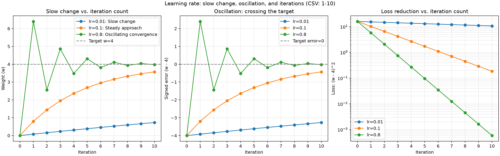

# 수동 갱신과 누적

해당 폴더를 VS Code로 열어 `main.py`의 TODO를 완성합니다. 함수를 처음부터 재설계하지 않고 제공된 흐름을 사용합니다.

**H03** — lr=0.1로 w를 갱신하세요. 아래 grad.zero\_()는 다음 반복에 이전 기울기가 섞이지 않게 합니다.

```powershell
python main.py
```

## 예상 출력

```text
1 0.0 -8.0 0.8 10.240001
2 0.8 -6.4 1.44 6.5536
3 1.44 -5.12 1.952 4.194304
4 1.952 -4.096 2.3616 2.684354
5 2.3616 -3.2768 2.68928 1.717987
6 2.68928 -2.62144 2.951424 1.099511
7 2.951424 -2.097152 3.161139 0.703687
8 3.161139 -1.677722 3.328911 0.45036
9 3.328911 -1.342177 3.463129 0.28823
10 3.463129 -1.073742 3.570503 0.184467
초기화하지 않은 gradient: 2.0 -> 4.0
```

CPU 검수 결과이며 device·버전과 학습 수치는 환경에 따라 달라질 수 있습니다. 상세 출력은 `expected/console.txt`에도 있습니다.

## 완료 조건

TODO의 계산을 코드로 확인하고 예상 결과와 비교합니다. 자신의 말로 입력 shape, 처리한 단계, 출력의 의미를 설명하세요. 단순히 실행 종료 코드가0인 것만으로 완료하지 않습니다.

## 내 기록

- 확인한 입력 / 출력:
  - 초기 가중치 `w=0`, 손실 함수 `L=(w-4)^2`, 반복 횟수 10회를 동일하게 두고 학습률 `0.01`, `0.1`, `0.8`을 비교했다.
  - `outputs/updates-0.01.csv`, `updates-0.1.csv`, `updates-0.8.csv`에 기록된 갱신 이후 가중치와 손실을 사용했다.
  - 각 반복에서 역전파로 기울기를 구하고 `w -= lr * w.grad`로 갱신한 다음, `w.grad.zero_()`로 기울기 누적을 방지했다.
- 결과의 의미:
  - `0.01`은 변화가 작아 10회 안에 목표값에 충분히 가까워지지 못했다.
  - `0.1`은 목표값을 넘지 않고 접근했으며, `0.01`보다 손실이 빠르게 감소했다.
  - `0.8`은 목표값 양쪽을 번갈아 지나면서 진동했지만 진폭과 손실은 감소했다. 이번 실험에서는 세 값 중 가장 빠르게 수렴했다.
- 잘못 이해했던 내용 또는 질문:
  - 학습률이 크다고 항상 발산하는 것은 아니다. 이번 `0.8`의 결과는 진동하면서 수렴하는 경우이다.
  - 손실은 오차를 제곱하므로 가중치가 목표값을 넘나드는 방향을 보여주지 않는다. 진동은 가중치 또는 부호 있는 오차 `w-4` 그래프로 확인해야 한다.

## 학습률 비교 보고서

### 그래프와 실행 방법

```powershell
python plot_learning_rates.py
```

Matplotlib이 필요하며, 그래프는 기존 CSV를 읽어 PNG와 SVG로 저장한다.



- 왼쪽: 반복 횟수에 따른 가중치 변화. 작은 학습률의 느린 변화와 목표값 `w=4`까지의 거리를 비교한다.
- 가운데: 부호 있는 오차 `w-4`. 0을 넘나드는지 확인해 진동을 구분한다.
- 오른쪽: 반복 횟수에 따른 손실 감소. 로그 눈금을 사용해 작은 손실까지 비교한다.

반복 1~10은 CSV의 실제 기록이며, 반복 0은 CSV의 최초 `w_before=0`과 손실 함수로 구한 초기 상태이다. 10회 이후의 실험 결과는 그래프에 추가하지 않았다.

### 10회 반복 결과

| 학습률 | 1회 갱신 후 w | 10회 갱신 후 w | 10회 갱신 후 손실 | 변화 양상                        |
| ------ | ------------- | -------------- | ----------------- | -------------------------------- |
| 0.01   | 0.080000      | 0.731709       | 10.681727         | 작은 폭으로 단조 증가, 느린 접근 |
| 0.1    | 0.800000      | 3.570503       | 0.184467          | 목표값 아래에서 단조 증가        |
| 0.8    | 6.400000      | 3.975813       | 0.000585          | 목표값 양쪽으로 진동하며 접근    |

### 느린 변화와 반복 수

`0.01`은 10회 후에도 목표값 4와 약 3.268291 차이가 난다. 같은 반복 횟수에서 갱신 폭이 작아 더 많은 반복이 필요하다. `0.1`의 최종 오차는 약 0.429497, `0.8`은 약 0.024187이다. 이번 10회 비교에서는 `0.8`이 가장 작은 오차와 손실을 보였다.

이 손실 함수의 기울기는 `2(w-4)`이므로 갱신식은 `w_next-4 = (1-2*lr)(w-4)`이다. 이론적으로 매 반복마다 오차에 각각 `0.98`, `0.8`, `-0.6`이 곱해진다. `0.01`은 오차 감소가 느리고, `0.8`은 오차 부호가 바뀌면서 크기가 줄어드는 이유를 설명한다.

예를 들어 `|w-4| < 0.1`을 기준으로 잡으면, 초기 오차 4에서 필요한 반복 수는 위 식으로 계산할 때 각각 183회, 17회, 8회이다. 이는 동일한 갱신식을 이상적인 실수 연산으로 계산한 이론값이며, 실제 CSV로 확인한 범위는 10회까지이다. `0.8`은 실제 8회 값 `w=3.932816`에서 이 기준을 만족한다.

### 진동과 수렴에 대한 해석

`0.8`에서는 가중치가 `0 → 6.4 → 2.56 → 4.864`로 움직인다. 목표값 4를 반복해서 지나치지만 오차의 크기가 줄어들어 손실은 계속 감소한다. 따라서 이 결과를 발산으로 해석하면 안 된다.

이번 함수에서는 `0 < lr < 1`일 때 오차가 수렴하며, `0.5 < lr < 1`에서는 부호가 바뀌는 진동이 나타난다. 이 범위는 `L=(w-4)^2`에 대한 분석이며 다른 모델의 적절한 학습률에 그대로 적용할 수 없다. 이번 결과로는 작은 학습률의 느린 변화, 큰 학습률에서 나타날 수 있는 진동, 목표 오차에 도달하는 데 필요한 반복 수의 차이를 확인했다.
