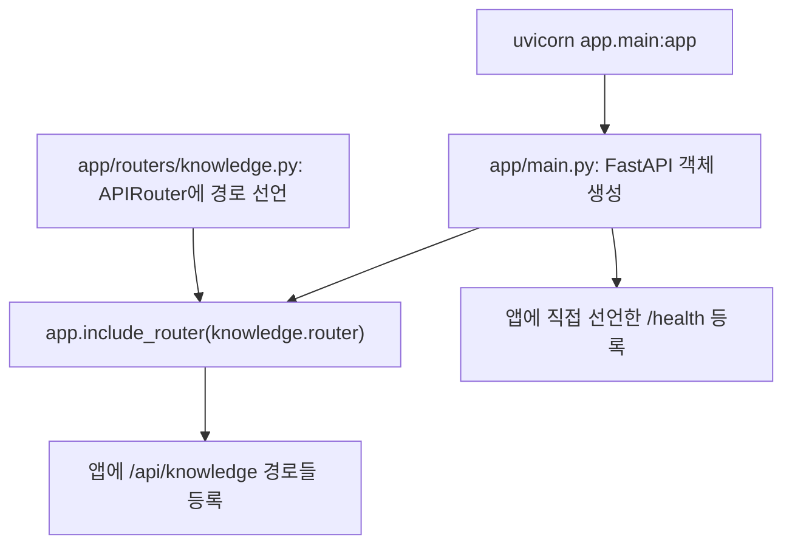
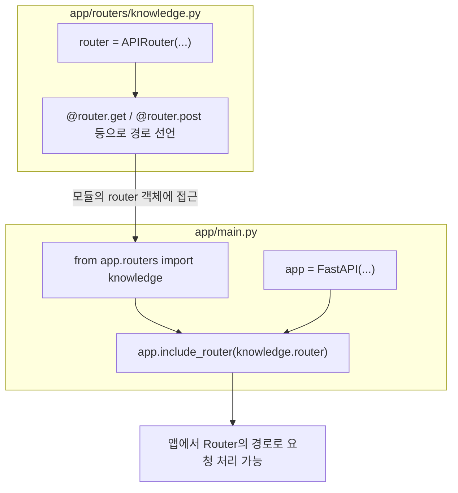
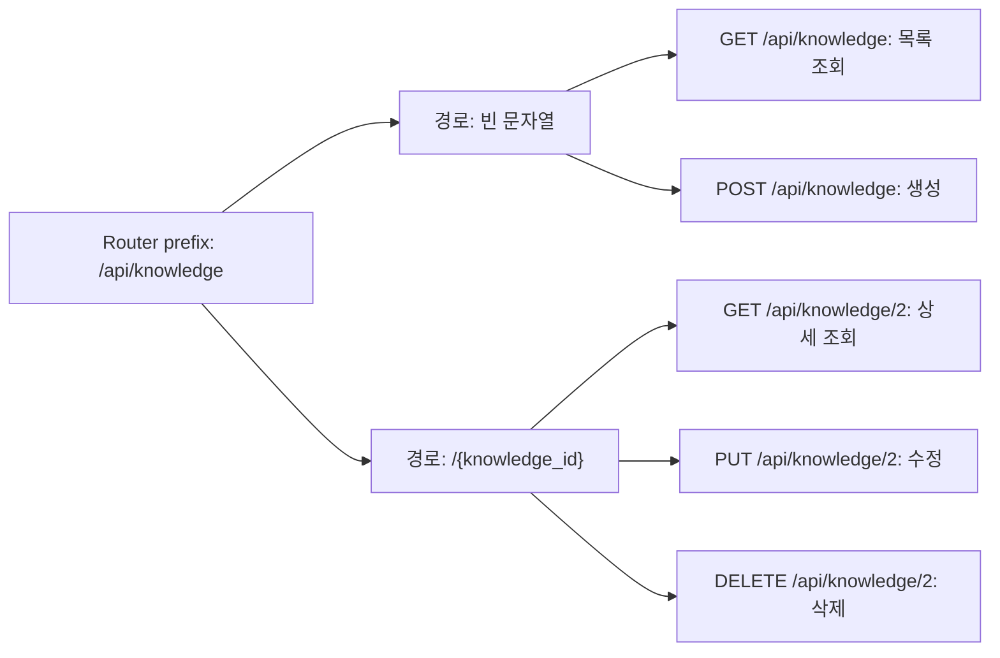
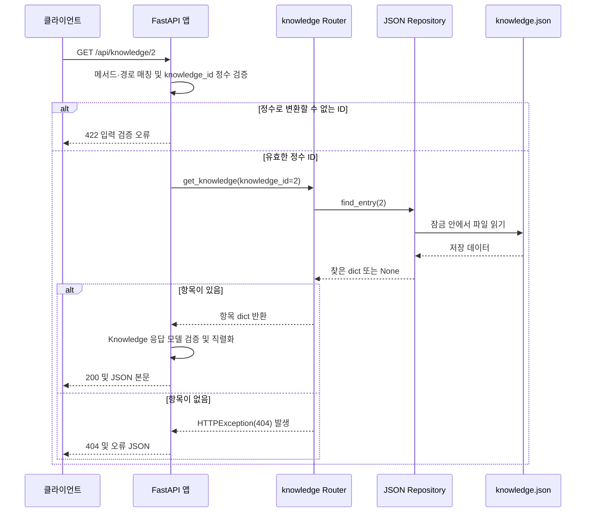

# 실습 06 · 파일 역할 이해·분리

수강생용입니다. BEGIN/END 사이 TODO를 구현합니다. 미완성 요청은 NotImplementedError 또는 미등록 Route로 실패할 수 있습니다.

**PPT 39–46쪽 / 35분 / 심화**

## 작업 순서

1. 이전 교시 서버를 Ctrl+C로 종료합니다.
2. 아래 교시 폴더를 현재 작업 폴더로 사용합니다. 이 폴더가 프로젝트 루트입니다.
3. 요구된 TODO를 구현하고 서버를 실행합니다. 앞 교시가 미완성이어도 이 폴더의 선행 기능은 제공되어 있습니다.
4. /docs에서 아래 예상 결과와 실제 파일을 대조합니다.

```powershell
# 수강생용 폴더에서 시작한 경우
cd ".\03_심화\06_structure"
python -m uvicorn app.main:app --reload
```

브라우저: `http://127.0.0.1:8000/docs` · 첫 확인: `http://127.0.0.1:8000/health`

활성화를 하지 않았다면 현재 교시 폴더에서 다음처럼 같은 가상환경 Python을 직접 사용합니다.

```powershell
..\..\.venv\Scripts\python.exe -m uvicorn app.main:app --reload
```

심화의 app.main:app 실행에서도 app 폴더 안으로 cd하지 않습니다. 새로운 교시로 이동할 때 이전 서버는 반드시 종료합니다.

## 완성할 부분

| TODO ID | 파일                                 | 완료 요구사항                                                            |
| ------- | ------------------------------------ | ------------------------------------------------------------------------ |
| H06-01  | `app/main.py`                        | knowledge 모듈의 router를 app에 포함하세요. 추가 prefix를 붙이지 마세요. |
| H06-02  | `app/repositories/json_knowledge.py` | Repository의 목록 조회 결과를 반환하세요. HTTP Response를 만들지 마세요. |
| H06-03  | `app/routers/knowledge.py`           | 검증된 payload를 dict로 바꾸어 repo.create에 전달하고 결과를 반환하세요. |
| H06-04  | `tests/test_api.py`                  | 상세 응답의 키가 id·title·content·category 네 가지인지 검사하세요.       |

## 요청·응답·저장 확인

1. GET /health → 200, {"status":"ok"}
2. GET /docs → 200인 문서 화면. 실행 결과는 Server response에서 읽습니다.
3. 초기 파일: next_id=4, entries 3건 (ID 1·2·3). 이 폴더에서 이미 변경했다면 실제 상태를 먼저 확인합니다.
4. GET /api/knowledge → 200, entries 배열만 반환. GET /api/knowledge/2 → title=서버 실행.
5. GET /api/knowledge/9999 → 404, detail=Knowledge not found. GET /api/knowledge/foo → 422. GET 전후 파일은 변하지 않습니다.
6. category=api → 초기 ID 2·3, category=setup → 초기 ID 1, category=unknown → 200과 []. 생략은 전체입니다.
7. 정상 POST → 201. 초기 상태에서 첫 생성 ID는 4이며 entries=4건·next_id=5입니다. 실제 응답 ID로 재조회합니다.
8. 빈 content·필수값 누락·길이 초과 POST → 422, entries와 next_id 불변. 422 문구 전체는 버전별로 다를 수 있습니다.
9. PUT은 title·content·category를 모두 보냅니다. 정상 200·같은 ID·같은 개수·같은 next_id. 존재하지 않는 ID는 404, content만 보내면 422.
10. DELETE 정상 → 204와 빈 본문. 같은 ID GET/DELETE → 404. 나머지 지식과 next_id는 유지됩니다.

## 자동 검사 (선택한 심화 수준의 과제)

가상환경에 requirements-test.txt의 패키지를 설치한 뒤, 현재 프로젝트 루트에서 실행합니다.

```powershell
python -m pytest -q tests/test_api.py
```

conftest.py가 각 테스트마다 임시 파일을 새로 만들고 DATA만 바꿉니다. 실제 data/knowledge.json을 건드리지 않습니다.
정답이 미완성이면 테스트가 실패하는 것이 정상입니다. 테스트를 지우거나 assert를 pass로 바꾸지 마세요.

## 완료 기준과 주의

요청 Method·Path·Body·상태코드와 파일의 변화를 설명할 수 있어야 합니다. 코드가 실행된다는 이유만으로 정답은 아닙니다.
이 교시의 저장 파일은 이 폴더의 data/knowledge.json이며, 다른 교시와 공유하지 않습니다. 01에는 저장 파일이 없습니다.
파일 처리·잠금·초기화 도구는 제공 코드입니다. 내부를 모두 새로 구현하는 과제가 아닙니다.
/health는 경로 응답 확인일 뿐 AI 모델·DB 준비 상태를 확인하지 않습니다. 인증·DB·LLM 호출은 오늘 추가하지 않습니다.

## 구현 검토 및 수정 기록

비교 기준은 `../../../mentor/03_advanced/06_structure/`의 정답 파일입니다. 직접 수정한 구현과 테스트는 그대로 두고, 기존 풀이의 문제와 해결 과정을 정리했습니다.

### 이번 과제의 파일 역할

| 파일                                 | 역할                                                                 |
| ------------------------------------ | -------------------------------------------------------------------- |
| `app/main.py`                        | FastAPI 앱을 만들고 Router를 등록함                                  |
| `app/routers/knowledge.py`           | HTTP 경로·상태 코드·입력 및 응답 모델을 선언하고 Repository를 호출함 |
| `app/repositories/json_knowledge.py` | 데이터 조회·ID 발급·변경·파일 저장을 담당함                          |
| `app/schemas.py`                     | 입력과 응답에 사용할 Pydantic 모델을 정의함                          |
| `tests/test_api.py`                  | HTTP 응답과 임시 저장 파일을 검사함                                  |

H06-01은 `app.include_router(knowledge.router)`로 Router를 등록했습니다. Router에 이미 `/api/knowledge` prefix가 있으므로 앱 등록 시 추가 prefix를 붙이지 않았습니다. H06-02는 Repository에서 `entries`를 그대로 반환하여 HTTP 응답 생성과 저장 책임을 구분했습니다. 두 부분 모두 정답과 같습니다.

### 잘못 풀었던 H06-04: 포함 여부와 정확한 일치의 차이

처음 작성한 코드는 다음과 같습니다.

```python
required_keys = ("id", "title", "content", "category")
assert set(required_keys).issubset(r.json())
```

딕셔너리를 순회하면 키를 얻으므로, 이 코드는 필수 키 네 개가 응답에 포함되어 있는지 확인합니다. 하지만 과제는 상세 응답의 키가 정확히 네 가지인지 검사하도록 요구합니다. `issubset()`은 추가 키를 허용하므로 응답에 `next_id` 같은 내부 정보가 포함돼도 통과합니다.

예를 들어 다음 응답도 기존 검사를 통과합니다.

```python
response = {
    "id": 1,
    "title": "가상환경",
    "content": "프로젝트별 패키지를 분리한다.",
    "category": "setup",
    "next_id": 4,
}
required_keys = {"id", "title", "content", "category"}
assert required_keys.issubset(response)  # 추가 키가 있어도 통과
assert set(response) != required_keys  # 정확한 키 집합은 다름
```

직접 수정한 현재 코드는 다음과 같습니다.

```python
required_keys = {"id", "title", "content", "category"}
assert set(r.json()) == required_keys
```

이제 필수 키가 빠지거나 추가 키가 생기면 모두 실패합니다. 집합으로 비교하므로 키의 순서는 검사하지 않습니다. 수정의 핵심은 튜플을 집합으로 바꾼 것보다, 부분집합 검사 `issubset()`을 집합의 동등 비교 `==`로 바꾼 데 있습니다.

mentor 정답은 같은 집합을 변수 없이 바로 비교합니다.

```python
assert set(r.json()) == {"id", "title", "content", "category"}
```

현재 코드는 `required_keys`라는 변수를 사용한다는 점만 다르고 검사 조건은 같습니다.

### H06-03: dict(payload)와 model_dump()의 차이

현재 작성한 코드는 다음과 같습니다.

```python
payload_dict = dict(payload)
result = repo.create(payload_dict)
return result
```

mentor 정답은 다음과 같습니다.

```python
return repo.create(payload.model_dump())
```

현재 `KnowledgeWrite`의 필드는 title·content·category이며 모두 문자열입니다. 따라서 이 모델에서는 두 방식 모두 같은 내용의 딕셔너리를 Repository에 전달하고, 현재 구현도 요구사항을 충족합니다. 중간 변수로 처리 단계를 나눈 것도 동작 차이를 만들지 않습니다.

다만 `dict(payload)`는 필드 값을 그대로 가져오므로 중첩 Pydantic 모델이 있다면 그 값은 모델 객체로 남습니다. `payload.model_dump()`는 중첩 모델까지 딕셔너리로 변환합니다. 모델을 딕셔너리로 직렬화하는 의도를 표현할 때는 정답의 `model_dump()`가 더 적합합니다. 이 부분은 현재 과제에서 실패한 구현이 아니라 정답과 표현 및 변환 방식이 다른 부분입니다.

### mentor 정답과 현재 구현 비교

| 항목                | 현재 구현                                       | mentor 정답과의 차이                                         |
| ------------------- | ----------------------------------------------- | ------------------------------------------------------------ |
| H06-01 Router 등록  | `app.include_router(knowledge.router)`          | 동일                                                         |
| H06-02 목록 반환    | `return entries`                                | 동일                                                         |
| H06-03 생성 위임    | `dict(payload)`를 중간 변수에 담아 전달 후 반환 | 정답은 `model_dump()` 사용. 현재 문자열 필드에서는 같은 결과 |
| H06-04 응답 키 검사 | `set(r.json()) == required_keys`                | 정답은 집합을 직접 작성. 같은 검사 조건                      |
| 주석                | 수강생용 TODO 안내 주석 유지                    | 정답에는 해설 주석이 있으며 실행에는 영향 없음               |

### 검증 결과와 배운 점

수정 후 `tests/test_api.py`를 실행한 결과 **20개 테스트가 모두 통과**했습니다. 각 테스트는 임시 파일을 사용하므로 실제 `data/knowledge.json`을 변경하지 않았습니다.

수정 전에도 기존 테스트 20개는 통과했습니다. 당시 실제 응답에는 추가 키가 없어 약한 `issubset()` 검사도 통과했기 때문입니다. 이번 문제는 API 실행 실패가 아니라, 테스트가 요구된 응답 계약을 충분히 검사하지 못했던 것입니다. “필수 키를 포함한다”와 “정확히 그 키만 가진다”를 구분해 검사 조건을 작성해야 합니다.

## 라우팅 흐름 시각화

### 앱에 Router를 등록하는 과정

서버는 실습 06 폴더에서 `python -m uvicorn app.main:app --reload`로 실행합니다. `app.main`은 모듈 경로이고, 마지막 `app`은 그 모듈 안의 FastAPI 객체 이름입니다.



`APIRouter`에는 관련 경로를 모아 선언하고, `include_router()`로 앱에 등록합니다. 모듈을 import하는 것만으로는 해당 Router의 경로가 앱에 등록되지 않습니다. `/health`는 `@app.get()`으로 앱에 직접 등록합니다.

### knowledge.py의 APIRouter를 main.py에 연결하기

두 파일이 연결되는 실제 코드는 다음과 같습니다.

```python
# app/routers/knowledge.py
from fastapi import APIRouter

router = APIRouter(prefix="/api/knowledge", tags=["knowledge"])

@router.get("/{knowledge_id}")
def get_knowledge(knowledge_id: int):
    # 실제 구현에서는 Repository 조회 결과를 반환합니다.
    ...
```

위 코드는 연결 설명을 위해 상세 조회 하나만 남긴 축약 예시입니다. `router`는 APIRouter 객체를 담은 변수이고, `@router.get()`은 이 객체에 경로와 처리 함수를 등록합니다. 여기까지는 해당 Router에 경로가 모인 상태입니다.

```python
# app/main.py
from fastapi import FastAPI
from app.routers import knowledge

app = FastAPI(title="Knowledge API")
app.include_router(knowledge.router)
```

`from app.routers import knowledge`는 `app/routers/knowledge.py` 모듈을 가져옵니다. `knowledge.router`는 그 모듈 안에서 만든 APIRouter 객체를 뜻합니다. `app.include_router(knowledge.router)`를 실행하면 그 객체에 모인 경로들이 FastAPI 앱의 라우팅에 포함됩니다.



코드를 읽을 때는 **Router 객체 생성 → 데코레이터로 경로 선언 → main.py에서 모듈 import → include_router로 앱에 포함** 순서로 연결하면 됩니다. 실제 서버 시작 시에는 `main.py`의 import가 `knowledge.py`를 실행하게 하여 Router 객체와 경로를 준비하고, 이어서 앱을 만들고 Router를 포함합니다. `include_router()`는 앱 구성 시 실행되며, 요청이 올 때마다 다시 실행하는 코드는 아닙니다.

현재 `knowledge.py`는 `main.py`의 `app`을 가져오지 않습니다. 자신의 `router`에 경로를 선언하고, `main.py`가 그 Router를 가져와 앱을 조립하는 방향입니다.

### 최종 URL이 만들어지는 방식

현재 Router는 `prefix="/api/knowledge"`를 사용합니다. 앱 등록에는 추가 prefix가 없으므로, Router prefix와 각 데코레이터의 경로를 합치면 최종 경로가 됩니다. HTTP 메서드도 함께 사용해 실행할 함수를 구분합니다.



| HTTP 메서드 | 데코레이터 경로     | 최종 요청 예시     | 실행 함수            | Repository 호출                                   |
| ----------- | ------------------- | ------------------ | -------------------- | ------------------------------------------------- |
| GET         | `""`                | `/api/knowledge`   | `list_knowledge()`   | `repo.list_entries(category)`                     |
| GET         | `"/{knowledge_id}"` | `/api/knowledge/2` | `get_knowledge()`    | `repo.find_entry(knowledge_id)`                   |
| POST        | `""`                | `/api/knowledge`   | `create_knowledge()` | `repo.create(payload_dict)`                       |
| PUT         | `"/{knowledge_id}"` | `/api/knowledge/2` | `update_knowledge()` | `repo.update(knowledge_id, payload.model_dump())` |
| DELETE      | `"/{knowledge_id}"` | `/api/knowledge/2` | `delete_knowledge()` | `repo.delete(knowledge_id)`                       |

`/api/knowledge/2`의 `2`는 경로 매개변수 `knowledge_id`입니다. `/api/knowledge?category=api`의 `category`는 목록 조회 함수에 전달되는 쿼리 매개변수이며, 경로 자체는 `/api/knowledge`입니다. `tags=["knowledge"]`는 API 문서에서 경로를 묶는 이름이며 URL에 추가되지 않습니다.

### 상세 조회 요청부터 응답까지

아래는 `GET /api/knowledge/2`를 예로 든 흐름입니다. Router 함수 호출 전에 FastAPI가 경로 매개변수를 검증하고, Repository는 HTTP 응답 대신 데이터나 `None`을 반환합니다.



예를 들어 `/api/knowledge/foo`는 정수 검증 단계에서 422가 되므로 조회 함수 본문을 실행하지 않습니다. `/api/knowledge/9999`는 정수 검증을 통과하지만 저장된 항목이 없어 Router가 404를 발생시킵니다. Repository는 검색과 저장에 집중하고, Router는 그 결과를 HTTP 상태 코드와 연결합니다.
